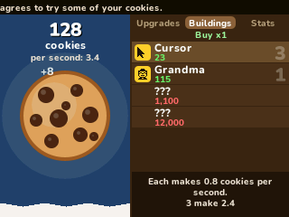

# Cookie Clicker

Click the big cookie. Buy buildings that bake for you, upgrades that make them bake more, and catch the golden cookies. Orteil's idle game for the NumWorks calculator, with its own numbers, names and news.

- **The 20 buildings**, from the Cursor and the Grandma to the Cortex baker and You, at the game's prices and cookies per second, each one 15% dearer than the last. Buy 1, 10 or 100 at a time; the next two you can't afford yet show as **???**, as in the game.
- **Upgrades with their real names and prices:** the cursor's Reinforced index finger, Carpal tunnel prevention cream, Ambidextrous and Thousand fingers (which grow with every other building you own), the first three tiers of every building's upgrades (Forwards from grandma, Cheap hoes, Sugar gas...), the mice that make each click worth a part of your cookies per second, flavored cookies from Plain cookies on, Lucky day, Serendipity and Get lucky. They show up as your bakery grows, cheapest first.
- **Golden cookies** appear every 5 to 15 minutes and stay 13 seconds: catch one for **Frenzy** (production x7 for 77 seconds), **Lucky!** (15% of your bank, up to 15 minutes of production) or, now and then, **Click frenzy** (clicks x777 for 13 seconds).
- **59 achievements** with the game's names, from Wake and bake to Clickolympics, and the **milk** they fill: every achievement is 4% milk, every 25 change its flavor, and the kitten upgrades turn it into more cookies.
- **The news ticker** tells how famous your cookies have become, from "nobody wants to eat your cookies" to the elder gods.
- The numbers read like the game's: 123,456, then 1.234 million, 56.7 billion and on to the duodecillions.
- Your bakery is saved as you play and when you leave. It only bakes while the game is open: the calculator has no clock to tell how long it was closed.

Left out to fit in NumPlay: ascension and prestige, selling buildings, grandma types, the higher tiers of upgrades and achievements, wrath cookies and the building specials, sugar lumps and the minigames.

## Controls

| Key | Action |
| --- | --- |
| OK (or 5) | Click the big cookie |
| shift | Catch a golden cookie |
| Up, Down (or 8, 2) | Choose a building, an upgrade or an achievement |
| Left, Right (or 4, 6) | Upgrades, Buildings, Stats |
| EXE | Buy it |
| × | Buy 1, 10 or 100 buildings at a time |
| Back | Menu: Resume, How to play, Quit game |

## Credits

Cookie Clicker is **[Orteil](https://orteil.dashnet.org)**'s game (DashNet, 2013). This version is written in C for NumPlay: the numbers, the names of the buildings, upgrades and achievements and the news follow the game (version 2.05), the cookie, the store's pictures and everything else are drawn for the calculator. It isn't affiliated with Orteil or DashNet.

Inside NumPlay it draws with the launcher's own shapes and fonts and unpacks its names with NumPlay's DEFLATE decoder, so the game itself is about 11 KB. `tools/data.py` makes `src/data.h` (the names, news and pictures); `tools/icon.py` draws the icon.

It comes inside [NumPlay](https://github.com/Mason363/NumPlay), or on its own as `CookieClicker.nwa` from the [latest release](https://github.com/Mason363/NumPlay/releases/latest).

Build: `make` (needs `arm-none-eabi-gcc` and Node.js for nwlink).
