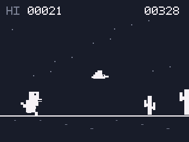

# Dino Run — NumWorks native C game (prototype)

An original endless runner inspired by offline dinosaur games, including the Chrome Dino game from Lily's NumWorks Python collection. The **C source code, pixel drawings and assets are independently written**; the Python version's code and sprites have not been copied. Unofficial, not affiliated with Google.



## Controls

| Key | Action |
|---|---|
| **OK**, EXE, Up / 8 | Jump / start / restart |
| **Down** / 2 (hold) | Duck (and fall faster mid-air) |
| **Back** or Backspace | Pause / resume |
| **SHIFT** at title | Help screen |
| **HOME** | Exit back to calculator |

The game features cacti, flying dinosaurs/birds, gradually increasing speed, day/night changes, high-score storage (`dinorun.sav`) and instant restart.

## Build as an individual NumWorks app

Requires the same EADK GCC + `nwlink` environment as the rest of NumPlay.

```sh
make -C games/dinorun check
```

Result: `games/dinorun/output/dinorun.nwa`.

You can also use `.github/workflows/dinorun-quick.yml` without installing build tools on Windows. It triggers on a push to a branch with changes in `games/dinorun/**`, runs a simple host test, builds the app and uploads **DinoRun-nwa**.

Install the `.nwa` using https://my.numworks.com/apps (Chrome/Edge). **NumPlay is already close to the calculator's entire app-space budget, so installing Dino Run separately may replace your existing NumPlay installation. Back up scripts and saves and reinstall NumPlay afterward.**

## Integration into the combined NumPlay launcher

`module` and `sim-module` targets are already included to support future integration. At present, **Dino Run is intentionally not added to `games/games.json`**, because the full NumPlay app was already close to the 2 MB flash cap. Adding the manifest entry now would make the full build fail unless enough flash is freed. See `INTEGRATION.md` in the standalone patch.

## Development checks

```sh
make -C games/dinorun host-test
```

Host tests cover jump motion, ducking, collision, game over, restart, and rendering. They do **not** replace on-calculator testing or NumPlay's ARM emulator suite.

The game is made as an independently coded fan-style runner, with a deliberately small screen buffer (16 RGB565 rows) to avoid allocating a full 320x240 framebuffer.
