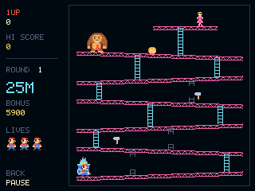

# Donkey Kong

**By Bobydeluxe.** A native arcade adaptation for NumWorks, with English menus,
original redrawn pixel art and the four arcade boards. No ROM or emulator is
required. It builds and installs as its own app, separately from the combined
NumPlay launcher. Not affiliated with Nintendo.



## Play

Download **DonkeyKong.nwa** from the [NumPlay releases](https://github.com/Mason363/NumPlay/releases/latest)
once a release includes this game, or build `build/apps/DonkeyKong.nwa` locally.
Install it with [my.numworks.com/apps](https://my.numworks.com/apps), then open
Donkey Kong from the calculator's Home menu.

| Key | Action |
| --- | --- |
| Left / Right, or 4 / 6 | Move |
| Up / Down, or 8 / 2 | Climb a ladder |
| OK / EXE / Shift | Jump |
| Back | Pause / go back |
| Home / On-Off | Save records and exit |

Reach Pauline on **25m** (barrels), **50m** (conveyors) and **75m** (elevators).
On **100m**, remove all eight blue rivets. Jump over the holes left behind.
The four boards repeat in order, with gradually faster obstacles; difficulty
is capped to keep later rounds playable.

Three lives, a single extra life at 7,000 points, temporary hammers, collectible
lost items and a countdown bonus are included. Long falls and running out of
bonus cost a life. Hammers prevent jumping and climbing until they expire;
the yellow bar under the lives shows the remaining time.

Pause offers **Resume**, **Restart** (with confirmation) and **Title**. An
unfinished run can be resumed from the title while the app remains open.
`donkeykong.sav` stores records only, not a suspended run: best score, runs,
rescues and highest round, in 32 bytes plus filesystem metadata. A full
filesystem offers retry, continued play, or exit without saving.

## Build

Requirements: Python 3.9+, Node.js, `nwlink` 1.0.0, and the ARM GNU toolchain
with newlib nano. Art and the PNG icon are generated with Python's standard
library; there is no asset download or external asset pack.

```sh
python build.py --arm-bin /path/to/arm/bin --nwlink /path/to/nwlink/bin/nwlink
```

With the tools on `PATH`, `python build.py` or `make build check` is enough.
`ARM_BIN` and `NWLINK` environment variables are also accepted. The build
checks that the compact release and debug app install to identical bytes
and that both fit the 107,674-byte RAM profile. From the repository root,
`make apps` builds and copies `DonkeyKong.nwa` alongside the other apps;
`make check` checks its RAM and release generation lists its download.

Host tests and screenshots:

```sh
make test HOST_CC=cc PYTHON=python
```

Actual ARM app tests, after building and running host tests:

```sh
python tests/test_arm.py --nwlink /path/to/nwlink/bin/nwlink
```

These use the repository's Unicorn emulator and require Unicorn, pyelftools
and Pillow. See [validation](VALIDATION.md) for measured sizes and test scope.

## Credits and scope

- Adaptation: **Bobydeluxe**.
- Original arcade game, characters and design: **Nintendo, 1981**.
- Reference: [Donkey Kong — Super Mario Wiki](https://www.mariowiki.com/Donkey_Kong_(game)).
- Packed pixel art is newly drawn in `tools/assets.py`. No extracted Nintendo
  sprites or ROM data are bundled.
- Uses the repository's shared Epsilon file/exit helpers and 5×7 lettering.
  Source code follows the repository's GPL-3.0-only license.

This is a calculator adaptation with layouts and timing adjusted for its
224×224 playfield, rather than a cycle-accurate arcade reproduction. It uses
all four boards per round and avoids the original late-game timer overflow.
