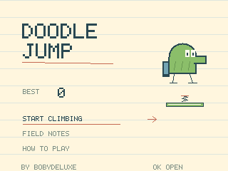
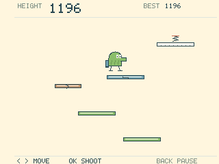

# Doodle Jump

Game made by **Bobydeluxe**.

A new NumWorks implementation of automatic jumping, bounded left/right steering and
an endless climb. The English interface keeps an ink-and-paper look with
lightly ruled menu pages and a clear playfield. Decorative binding, dense grid,
side rulers, extra annotations and note shadows have been removed.
The character, platforms, monsters and interface are drawn procedurally.




## Play

Install the standalone `DoodleJump.nwa` with a compatible NumWorks external-app
installer. Open Doodle Jump from the calculator's Home menu after installation.

| Key | Action |
| --- | --- |
| Left / Right, or 4 / 6 | Steer; stop at the left and right walls |
| OK / EXE / Up | Shoot upward once; release before shooting again |
| Back | Pause, or return in menus |
| Home / On-Off | Save and exit |
| Arrows, then OK / EXE | Select a menu entry |

Jumping is automatic. Land on platforms while descending; rising through one
does not cause a collision. The camera climbs with you, and falling below the
page ends the expedition. Height determines the high score.

- **Green:** normal platform.
- **Blue:** moving platform.
- **Brown:** brittle; breaks without giving a bounce. These are optional ledges.
- **White:** one bounce, then disappears.
- **Spring:** land near its centre for a higher jump.
- **Rocket:** land near its centre for a temporary, protected flight.
- **Monsters:** shoot upward or land on top. Touching the side or underside
  ends the climb. Their patrols stay within the page.

The route uses seeded random short, medium and long offsets, including nearly
vertical jumps. Direction can change anywhere on the page; there is no fixed
left/right sweep. Proposals reflect near the edges instead of accumulating
there. After four route ledges in the same screen half, an inward bias prevents
staying there for more than six consecutive ledges. Consecutive base centres
stay within 68 pixels, while rises stay between 36 and 54 pixels. Moving
platforms remain inside the playfield. Higher climbs retain narrower, moving
and one-use platforms, springs, rockets and optional brittle ledges.

The character stays fully on the page. Holding a direction against a wall
stops horizontal speed; pressing the opposite direction moves away immediately.
There are no opposite-edge character copies or collisions across the page.
Old DJN1 and DJN2 saves import records and climbing progress into DJN3. DJN1 edge
positions and queued wrapping routes are adapted to the walls. DJN2 climbs
keep their visible platforms and exact progress; only generator history resets. New saves retain exact
state on subsequent reloads and remain 384 bytes.

**Field Notes** records the best height, expeditions, bounces, springs, rockets
and monsters cleared. Its animation option reduces cosmetic movement without
changing the physics. Pausing freezes the world; resuming waits on the ready
note. Starting a new expedition asks before replacing a live climb. From the
pause menu, **Title Page**, then **Back**, leaves the app with progress saved.

The 384-byte save includes the exact integer simulation state, generated
platforms, monsters, shots, statistics and animation preference. Invalid saves
are rejected before replacing live state. If saving fails, an interactive note
offers retry, return to the climb or an explicit exit without saving.

## Build

Requires ARM GCC with newlib, Python 3 and nwlink 1.0.0. The optional Python
builder additionally uses pyelftools; regenerating the icon uses Pillow.

```sh
make build check
make test
python tests/arm.py --nwlink nwlink

# Optional portable build, also usable on Windows without Make:
python tools/build.py --toolchain /path/to/arm/bin --nwlink /path/to/nwlink/bin/nwlink
python tools/icon.py
```

The builders use a game-local lossless icon/ELF packer. The Python builder checks
release/debug installed bytes on N0110, N0115/custom RAM, N0120 and Upsilon.
The unstripped debug NWA is used by the ARM regression suite. A module build is
provided for a later NumPlay integration.

| Resource | Bytes |
| --- | ---: |
| Downloadable NWA | 19,764 |
| Installed code and assets | 13,664 |
| Static RAM | 6,065 |
| Deepest observed ARM stack in exit/input tests | 548 |
| Save payload | 384 |

The renderer uses one 5,120-byte strip buffer. Physics uses fixed-point integers,
16 platform slots, three monsters and three shots. There are no heap allocations,
full-screen framebuffer or runtime image decompressor. The launcher icon is
409 compressed bytes with identical decoded pixels.

Simulation runs at 62.5 Hz and drawing at up to 31.25 Hz. The worst observed
render in the ARM emulator was 5 ms, including a crowded rocket scene. These
are emulator measurements; physical calculator display timing remains to be
checked. See [validation details](VALIDATION.md).
