> **Doom is a [NumPlay](../../README.md) game that comes on its own.** It is too big to sit next to NumPlay. Get `Doom.nwa` from the [latest release](https://github.com/Mason363/NumPlay/releases/latest).

  

<h1 align="center">Doom</h1>

  <b>Rip and tear through the moon bases of Mars, on the NumWorks calculator.</b> 
  id Software's Doom, the shareware episode: Knee-Deep in the Dead, all nine levels, run by the real Doom engine.

  <a href="https://github.com/Mason363/NumPlay/releases/latest/download/Doom.nwa"><b>Download Doom.nwa</b></a>
  &nbsp;·&nbsp; <a href="#controls">Controls</a>

  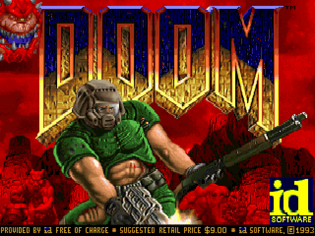

## Highlights

* **The real game:** the Doom engine itself (Chocolate Doom, by way of RP2040 Doom), not a lookalike. Monsters think, doors open, lifts rise and fall, barrels explode and the levels play exactly as on a PC in 1993: even the demos it plays on the title screen run as they were recorded.
* **Knee-Deep in the Dead, all of it:** Hangar, Nuclear Plant, Toxin Refinery, Command Control, Phobos Lab, Central Processing, Computer Station, Phobos Anomaly and the secret Military Base, with their secrets, keys, switches and the Barons of Hell at the end.
* **Everything from the shareware WAD:** every wall, floor, sprite, menu and screen, the status bar with the marine's face, the automap, the intermission maps of Phobos with your kills, items, secrets and time, and the episode's ending.
* **The whole 320 x 200 picture:** drawn at Doom's own resolution with its light levels and its palette, the screen flashing red when you're hurt and gold when you pick something up, and stretched to the calculator's 320 x 240 the way monitors of the day made Doom's pixels a little taller.
* **The five skill levels,** from I'm too young to die to Nightmare!, and the menus as they were: New Game, Options, Load Game, Save Game, Read This! and Quit Game.
* **Saved like in the game:** six save slots, named after their level. Home keeps the moment you were at, and the next start puts you back there. Your saves are also copied into `doom_saves.py`, so installing the app again doesn't erase them.

<table>
  <tr>
    <td align="center">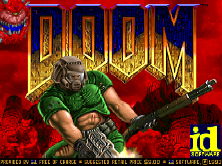 The title screen</td>
    <td align="center">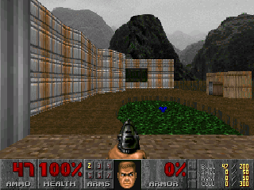 E1M1: Hangar</td>
  </tr>
  <tr>
    <td align="center">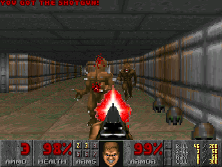 Imps down the corridor</td>
    <td align="center">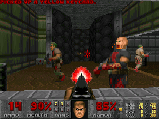 Zombiemen around the yellow key</td>
  </tr>
  <tr>
    <td align="center">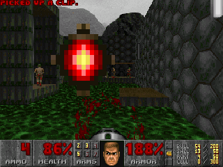 E1M5: Phobos Lab</td>
    <td align="center">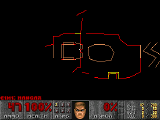 The automap</td>
  </tr>
  <tr>
    <td align="center">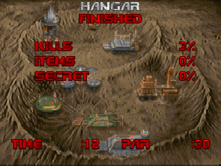 Hangar finished</td>
    <td align="center">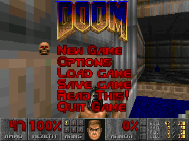 The main menu over the game</td>
  </tr>
  <tr>
    <td align="center">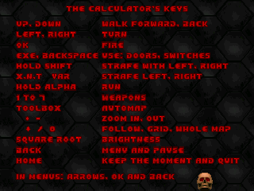 Read This!: the calculator's keys</td>
    <td align="center">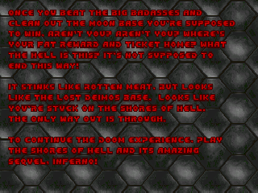 The end of Knee-Deep in the Dead</td>
  </tr>
</table>

## How to play

Press a key on the title screen for the menu, then choose New Game, Knee-Deep in the Dead and a skill level. Find the exit of each level, shooting what gets in your way: keycards open the doors of their colour, and walls that look a little different may hide a secret. Back opens the menu (and pauses the game), where you can save, load, change the options or read the keys again.

## Controls

| Key | What it does |
| --- | --- |
| Up / Down | Walk forward / back |
| Left / Right | Turn |
| OK | Fire |
| ⌫ or EXE | Use: open doors, press switches |
| shift (held) | Strafe with Left and Right |
| x,n,t / var | Strafe left / right |
| alpha (held) | Run |
| 1 to 7 | Choose a weapon |
| Toolbox | Automap (+ and − zoom, × follows you, ÷ shows the grid, 0 shows the whole map) |
| √ | Brightness |
| Back | Menu and pause; back one menu |
| Home | Keep the moment and quit |

In menus, the arrows choose, OK or EXE confirms and Back goes back. When the game asks a question, OK says yes and Back says no. Read This! in the menu shows these keys, and the very first game starts with a word on them.

## Good to know

* **No sound:** the calculator has no speaker, so Doom plays in silence.
* **Saves:** a save takes a few KB of the calculator's 42 KB of files, and its copy in `doom_saves.py` as much again. If there is no room, the game says so: delete a slot or an old script.
* **Its own pace:** the game thinks 35 times a second, as Doom always did, and draws up to 35 frames a second. Where a room is too much for the calculator, it draws fewer frames, but monsters, doors and you keep their speed.
* **The odd black stripe:** a frame has room for 3,600 slices of wall and sprite, as in RP2040 Doom. In the very busiest views, a narrow black stripe can flash for a frame where they run out.
* **Only the shareware episode:** the registered episodes (The Shores of Hell and Inferno) are not part of the free shareware WAD.

## How it's made

The calculator gives an app about 130 KB of RAM: Doom on a PC asked for 4 MB. This port runs Graham Sanderson's [RP2040 Doom](https://github.com/kilograham/rp2040-doom), which made all of the shareware DOOM1.WAD playable on a 264 KB microcontroller: the WAD is packed into its WHD format (1.4 MB without the sounds and music, read in place from flash), the levels are never copied to RAM, and the game's objects are squeezed with 16-bit pointers.

The calculator has less RAM still, and no room for a frame buffer: the screen is drawn 40 rows at a time. Each frame the engine walks the level once and keeps every column of wall, floor and sprite it would draw; then each band of rows is drawn from those lists, its floors and ceilings first, then its walls and things, texture by texture, and pushed to the screen through Doom's palette.

`make` builds `output/doom.nwa` (needs `arm-none-eabi-gcc` and Node.js for nwlink). `make test` plays it on a computer with the sanitizers on. `python3 tools/fetch.py build/ref` downloads the shareware DOOM1.WAD and `make data WAD=build/ref/doom1.wad` packs it again into `src/doom1.whx`.

## Credits

Doom is id Software's game (1993). Not affiliated with id Software, ZeniMax or Bethesda.

* **[RP2040 Doom](https://github.com/kilograham/rp2040-doom)** by Graham Sanderson: the engine, the WHD format and its converter (`tools/whd_gen`), and the renderer this port draws in bands.
* **[Chocolate Doom](https://github.com/chocolate-doom/chocolate-doom)** by Simon Howard and its contributors, which RP2040 Doom is made from.
* **The Doom source code** released by id Software in 1997 under the GNU GPL.
* **The shareware DOOM1.WAD** (version 1.9), which id Software lets anyone copy: its levels, pictures and texts.
* **[ADPCM-XQ](https://github.com/dbry/adpcm-xq)** by David Bryant and **[LodePNG](https://github.com/lvandeve/lodepng)** by Lode Vandevenne, used by the converter.

Made by Mason Chen as part of NumPlay.

## License

The engine is licensed under the GNU General Public License, version 2 or later (`COPYING.md`); RP2040 Doom's own files under the BSD 3-Clause license, as they say at their top; the converter's libraries under their own licenses (`tools/whd_gen`). NumPlay's code is licensed under the GNU General Public License v3.0: see the `LICENSE` file at the root of the repository. The shareware DOOM1.WAD packed into `src/doom1.whx` is id Software's, copied under the terms that let anyone share it.
