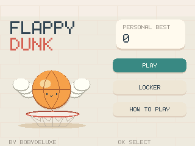
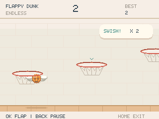
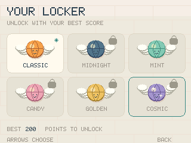

# Flappy Dunk

Game made by **Bobydeluxe**.

An English-only NumWorks game inspired by one-button basketball. Fly a winged
ball and descend through every hoop. Menus, physics and procedural artwork
are original; no mobile-game assets are bundled.




## Play

Install `FlappyDunk.nwa` with a compatible NumWorks external-app installer.
This PR provides a separate application; open Flappy Dunk from the calculator's Home menu after installation.

| Key | Action |
| --- | --- |
| OK, EXE or Up | Flap once; release before the next flap |
| Back | Pause during flight; go back in menus |
| Home or On/Off | Save and exit |
| Arrows | Choose a menu item or ball |

The title has three choices: **Play / Continue**, **Locker**, **How to Play**.
The two decorative slogans, Flight School, challenges and medal system have
been removed. Only endless flight remains, with gradually increasing speed.

Pass through hoops from above, with the entire ball clearing the rim. A normal
basket earns one point. A centred shot without rim contact is a swish;
consecutive swishes award 2, 3, 4, then 5 points each. Missing a hoop or hitting
the floor or ceiling ends the flight. The green marker identifies the next hoop.

The Locker's balls are cosmetic and do not change difficulty. New unlocks
use the best score from a single endless run:

| Ball | Required best score |
| --- | ---: |
| Classic | Available from the start |
| Midnight | 15 |
| Mint | 35 |
| Candy | 70 |
| Golden | 120 |
| Cosmic | 200 |



Previously earned balls remain unlocked when importing an old save, including
those obtained through the former medal system. No new medals can be earned
or used. The selected ball, best and lifetime statistics survive the update.
A normal flight resumes; an old challenge opens a fresh endless flight instead.

Continuing opens a ready screen and waits for a fresh flap. Pause freezes
simulation. Replacing a flight asks for confirmation. A full-storage exit
offers Retry, Return, or an explicit exit without saving.

## Build and verify

Requires ARM GCC, Python 3 and nwlink 1.0.0:

```sh
make build check
make test playability
python tests/arm.py --nwlink /path/to/nwlink

# Optional portable standalone build
python tools/build.py --toolchain /path/to/arm/bin --nwlink /path/to/nwlink/bin/nwlink
```

The Python build needs pyelftools and creates `output/FlappyDunk.nwa`, a debug
build, an optional module object, four linked profiles and `output/sizes.json`. Pillow
is needed to regenerate the launcher icon with `tools/icon.py`. The game-local
lossless packer verifies that release/debug apps install identical bytes.

The host suite tests scoring, rim contact, missed hoops, score-unlock
boundaries, old save import, corruption rejection, 120,000 physics ticks and
pixel-exact dirty redraws. The offline controller reaches 50 baskets through
normal flap input; it is not shipped in the game. Run both host programs before
the ARM suite because they generate its save and keyboard fixtures.

The title screen credits **Bobydeluxe**.

No heap or full-screen framebuffer: a 5,120-byte strip buffer, three reusable
hoops and sixteen bounded particles. The fixed `FDK2` save payload remains
160 bytes and imports `FDK1`. Older apps cannot read the new format. See
[VALIDATION.md](VALIDATION.md) for measurements and limitations.

Licensed under GPL-3.0-only, like NumPlay.
