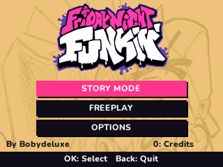
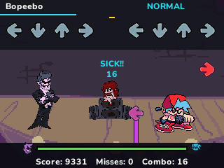

# Friday Night Funkin' — calculator adaptation

Native, silent adaptation by **Bobydeluxe** for the NumWorks N0110, N0115 and N0120. Standalone large-game download, outside the NumPlay launcher and customizer kit. English interface.

 

From the repository root, build it with `make build/data/apps/FridayNightFunkin.nwa` or `python tools/build.py --game fnf`. The release catalogue lists it among the individual big games. This fan adaptation is not affiliated with The Funkin' Crew.

The pinned official content contains **27 songs and 166 playable charts**: Tutorial, Weeks 1–7, Weekend 1 and the LE SSERAFIM collaboration. Freeplay includes the original, Erect/Nightmare, Pico and Boyfriend variations wherever present in those source files. Story Mode runs each week's songs in sequence. All weeks and charts are selectable from the start.

There is **no music, voice, sound effect, encoded silent audio or video** in the installed app. A clock, visual countdown and beat cue drive play. The app ends a song 1.2 seconds after its final charted note/hold or event; an audio file's uncharted tail is not included.

## Controls

| Action | Keys |
| --- | --- |
| Left / Down / Up / Right notes | Left / Down / Up / Right arrows **or 7 / 8 / ( / )**, respectively |
| Chords and holds | Press lanes together; keep the key down for a long note |
| Select / Confirm | OK or EXE |
| Pause / Back | Back |
| Week or song | Up / Down |
| Difficulty | Left / Right |
| Freeplay variation | 1 |
| Credits on title | 0 |
| Save and leave | Home or Power |

Arrow and number aliases are combined before detecting presses. Pressing both aliases for a lane produces one hit; releasing one while keeping the other pressed preserves the hold. Menus use the arrow keys. Options provide downscroll, ghost tapping (off by default) and beat animation.

## Gameplay and fidelity

The native engine retains **all 90,437 notes from the 166 player charts**, including opponent notes, chords, long notes, note kinds, difficulty, scroll speeds and BPM changes. Time and duration are quantized to 1/16 millisecond (at most 0.03125 ms error each). Notes are read from flash, with a bounded 64-note working queue. The PBOT1 scoring curve, 45/90/135/160 ms judgements, health, combo rules, hold rewards and drop penalties follow the pinned source. The source's two `picospeaker` charts are auxiliary NPC animation tracks, not additional player levels; their original data is retained in the source model but they are not playable chart entries.

This is a C adaptation for a 320×240 calculator, **not the Haxe/Flixel runtime**. Original artwork is reduced to native display sizes and a 15-colour palette per sprite, with up to four selected frames per animation. All 21 referenced stages and 46 character configurations are converted. Stage backgrounds use one composited frame; framing, camera effects, character placement, scripted fights and collaboration lighting are simplified. Complex desktop cinematics, shaders, background actors' choreography, editor, online functions and video are not reproduced. It is not a pixel-for-pixel reproduction of the desktop game.

Saved records contain each chart's best score, best completion and best combo, completed weeks and options. Completion follows the source's `(Sick + Good - Missed) / player notes`, clamped to 0–100%. Best records are updated on a successful clear. A failed run or retry does not erase them.

## Storage and RAM

The final build sizes and hash are written to `output/build-report.json`. Both released and debug packages must produce identical installed bytes and fit the shared **2,031,616-byte flash budget**; compilation/install checks use the smaller **107,674-byte RAM allocation** too.

Artwork and note streams remain in flash. RAM contains one 9,600-byte half-resolution background cache, one 5,120-byte LCD strip, the bounded note/input queues and small game/save state. There is no full framebuffer, dynamic allocation, whole-song note array, decoded atlas or on-device JSON parser. Keyboard transitions are sampled between LCD strips and judged using their wall-clock timestamps, independent of rendering frequency. Pausing freezes the chart clock; retry resets the stream and all per-run state.

The `fnf.sav` record is versioned and CRC checked. An inert Python script `fnf_save.py` carries a comment-only hexadecimal backup so records can be recovered after reinstalling an app; its contents are parsed as data, never executed. Both files use about 4.1 KB including record names. Keep the backup if reinstalling. If storage is full, the app shows Retry / Return to menu / Exit without saving. It preserves unrelated calculator records.

## Build and validation

With ARM GCC, Python 3 (Pillow for importing art), Node and nwlink available:

```sh
python build.py --arm-bin /path/to/arm/bin --nwlink /path/to/nwlink
make test HOST_CC=cc
python tests/test_assets.py
python tests/test_arm.py --nwlink /path/to/nwlink
```

The build needs only the checked-in packed inputs and original-art icon. To reimport the large reference assets, use `tools/import_reference.py --reference PATH`; the reference directory must contain the exact pinned repositories under `original/` and their license files. `tools/assets.py` builds deterministic C ROM tables from `assets/model.json.zlib`, `assets/art.json` and `assets/art.bin`. Generated `src/data.c` and `src/ids.h` are ignored build outputs; the Makefile generates them before parallel compilation. `assets/chart-manifest.json` is checked in for review. All three reproduce from the packed inputs.

The artifact is `output/fnf.nwa`, also copied to the workspace's `build/apps/FridayNightFunkin.nwa`. See [VALIDATION.md](VALIDATION.md) for the measured checks and their limits.

## Credits and rights

Original game, characters, charts, logo and art: **The Funkin' Crew and the original contributors**, credited in the pinned projects. Native calculator adaptation: **Bobydeluxe**. The interface uses NumPlay's Nunito font (SIL OFL 1.1).

See [ASSETS.md](ASSETS.md) for source revisions and conversion details. The upstream code is Apache 2.0; the separate art/assets license reserves copyright and explicitly restricts public redistribution. This local build does not grant redistribution rights. Original content is not relicensed under NumPlay's license. The PR records this upstream licensing limitation for maintainer review; no additional art redistribution permission is asserted.
