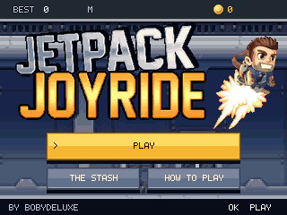
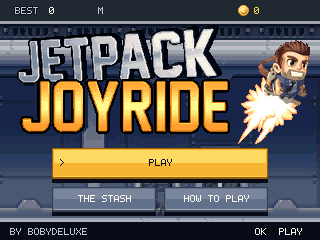
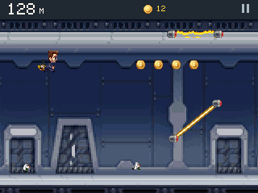
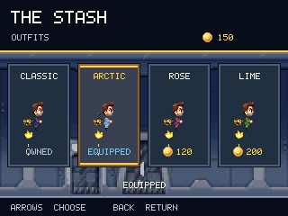

# Jetpack Joyride

By **Bobydeluxe**. An English-only NumWorks adaptation with artwork from the
[Jetpack Joyride Facebook assets archive](https://archive.org/download/jetpack-joyride-assets),
created by **Halfbrick**. See [artwork provenance](assets/README.md).






## Play

Install standalone `JetpackJoyride.nwa` with a compatible NumWorks external-app
installer, then open Jetpack Joyride from the calculator's Home menu. Build and
install it separately from the combined NumPlay launcher. A module build is
provided for later integration.

| Key | Action |
| --- | --- |
| Hold OK / EXE / Up | Thrust upward |
| Release | Fall; no fuel limit |
| Back | Pause, or return in menus |
| Home / On-Off | Save and exit |
| Arrows, then OK / EXE | Select a menu entry |

The main menu uses the original silver/gold wordmarks, character artwork,
a slowly scrolling laboratory and large industrial buttons. **Play/Resume**,
**The Stash** and **How to Play** are the three entries. The credit remains
**by Bobydeluxe**. The guide, shop, pause, restart, purchase and result screens
share the new steel/navy/gold design, with all text in English.

During play, Barry runs or flies with the original head/body animation frames
and a machine-gun jetpack. The supplied laboratory wall and floor scroll past
background scientists, spinning coins, electric zappers, missiles and shields.
Rotating zappers use matching electric colours and the original endpoint
sprites. The compact HUD shows meters, run coins, pause bars and an equipped
shield. Original images are resized and palette-adapted to the 320x240 display.

Keep changing altitude. Laser groups include a low/high/low slalom, a narrow
gate followed by a middle beam, a staircase, vertically offset gates and paired
rotating beams with floor/ceiling bars. The opening weave blocks floor, ceiling
and centre camping. Static columns are 260 pixels apart, rotating columns 300.
Every fifth group is a missile: its warning follows your altitude, locks, then
fires. Move after the lock. Shields absorb one hit and do not stack.

Collected coins enter a persistent wallet immediately. **The Stash** previews,
buys and equips permanent outfits: Classic is free, Arctic costs 50 coins,
Rose 120 and Lime 200. Purchases require confirmation; owned outfits can be
re-equipped for free. Outfits only change appearance. Existing purchases and
wallet balances are retained.

Distance determines the record. Speed increases from 2.25 to 4.5 pixels per
16 ms simulation tick. Rotating beams complete a revolution in 128 ticks,
with both directions and varied initial phases. Their collider follows the
finite beam, so empty corners are safe. Flights end at 1,000,000 meters to
keep counters bounded. Physics and obstacle generation are unchanged by the
artwork revision.

Pausing freezes the simulation; resuming waits for a fresh launch press.
Restarting asks before replacing a live flight. The checked 260-byte JJN2 save
preserves the exact world, random state, obstacle phases, records, wallet and
outfits. JJN1 saves still import their world and lifetime coins. Full-storage
recovery offers retry, return, or explicit exit without saving. Other
calculator records are preserved.

## Build

Requires ARM GCC with newlib, Python 3 and nwlink 1.0.0. The portable builder
also uses pyelftools. Pillow is needed only for asset regeneration and
screenshot/ARM tests, not the ordinary ARM build.

```sh
make build module check
make test
python tests/arm.py --nwlink nwlink
python tests/menu.py --nwlink nwlink

# Optional portable build, including Windows without Make:
python tools/build.py --toolchain /path/to/arm/bin --nwlink /path/to/nwlink/bin/nwlink

# Optional offline sprite/icon regeneration:
python tools/assets.py
python tools/assets.py --check
```

Generated sprites live in `src/assets.h`. The source manifest records original
filenames and hashes. The game-local icon/ELF packer verifies identical release/debug
installed bytes on four target profiles. Native tests create ARM fixtures in
`output/`; the ARM suite uses the unstripped debug NWA.

| Resource | Bytes |
| --- | ---: |
| Downloadable NWA | 57,432 |
| Installed code/assets | 49,732 |
| Static RAM | 5,857 |
| Deepest observed ARM stack | 436 |
| Save payload / with record overhead | 260 / 281 |
| Compressed launcher icon | 1,559 |

The artwork increases flash storage compared with the preceding procedural
version (20,008 downloadable / 13,804 installed bytes). Static RAM and save size
are unchanged. The device stores only the packed sprites it uses; the original
archive and source PNGs are not installed on the calculator.

One 320x8 RGB565 strip uses 5,120 bytes. Row-indexed RLE, packed 4-bit literals
and shared outfit palettes avoid full-screen textures in RAM, a PNG decoder,
heap allocations and texture caches. The laboratory repeats one small tile at
2x scale. Fixed-point physics uses four hazard slots and eighteen pickup slots.

Simulation runs at 62.5 Hz and drawing at up to 31.25 Hz. The title's independent
80 ms cosmetic clock never advances the saved simulation. Static menus push
no pixels when unchanged. All tested ARM scenes stay within the 32 ms drawing
budget; measured maximum is 12 ms. These are emulator measurements; physical
calculator display timing remains to be checked. See [validation](VALIDATION.md).
