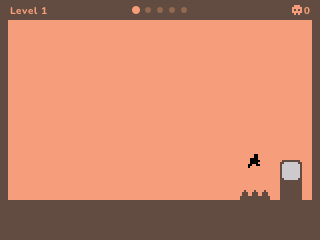

# Level Devil

Run to the door. The level has other plans. Unept's troll platformer on the NumWorks calculator, with the game's own rooms: all sixteen worlds of five rooms, their tiles, their traps and their timing, in the game's flat colours with its tiny black runner.

- **The 80 rooms of the game, in its order:** Pits, Spikes, Push, Coins, Controls, Platforms, Springs, Warps, Scale, Doors, Saws, Flappy, Gravity, Movement, Wraparound and the Boss, each in its own colours. Clear a world's five rooms to open the next one.
- **The game's traps, as it times them:** floors that drop or slide away, spikes that pop up in waves, walls that push you into pits, coins over fake ground, controls that turn round, platforms that sink under you, springs and warps that send you the wrong way, a runner that grows and shrinks, doors that run off or swap places with you, saws that chase you, gravity that flips, rooms where you fly, slide, float or wrap round the screen, and the Devil's giant saw.
- **Its feel:** the runner's speed, jump and gravity, its five-step grace after running off an edge, springs, ice and moving platforms that carry you.
- **Its look:** the black runner and its running and jumping pictures, the doors, spikes, saws, springs, warps, buttons and coins, the five squares of the world's rooms at the top, the shards of the runner when it dies, and the retry button: press any key to try again.
- **Deaths counted,** for the world and in all, with your best (the fewest deaths) for each one. The game remembers the room you reached, so you can stop any time, and keeps a copy of its save in `leveldevil_saves.py`, so installing the app again doesn't erase it.

## Controls

| Key | Action |
| --- | --- |
| Left, Right (or 4, 6) | Run |
| Up, OK or EXE (or 8, 5) | Jump (in Gravity: turn gravity round; in Flappy: flap) |
| Down (or 2) | Jump, in the room that says so |
| Any key, once dead | Try again |
| Arrows, OK | Pick a world on the map |
| Back | Pause: Resume, Restart the room, Levels, Quit game |
| Home | Quit |

## Credits

[Level Devil - NOT A Troll Game](https://store.steampowered.com/app/3242750/) is **Unept**'s game (2023). This version is written in C for the calculator, with no code of the original. Its rooms are the original's: [tools/fetch.py](tools/fetch.py) takes each room's tiles and actors (where each one is, its type, size and turn) from the game's web build and keeps them in [tools/scenes.json](tools/scenes.json), and [tools/rooms.py](tools/rooms.py) has what each room's script does (what each trigger sets off, after how long, how far and how fast), written out from the game's scene scripts. The runner's speeds and jump, the gravity of each room and the colours of each world are the game's; its pictures are drawn from the game's sprites.

`make test` plays every room through on a computer with the keys in [tests/solutions.txt](tests/solutions.txt) (found by a search, `build/play search`), so each one can be cleared.

It comes as its own app, `LevelDevil.nwa`, from the [latest release](https://github.com/Mason363/NumPlay/releases/latest).

Build: `make` (needs `arm-none-eabi-gcc`, Python 3 and Node.js for nwlink).
