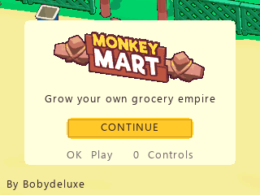
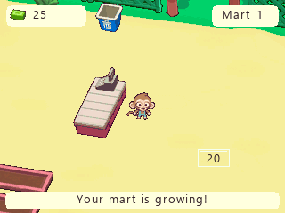
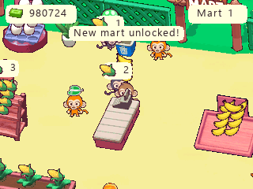
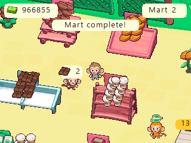

# Monkey Mart

Native NumWorks adaptation by **Bobydeluxe**, based on TinyDobbins' Monkey Mart.

The supplied reference is version **2.1**. It contains **two playable marts**;
its third-mart module is commented out and absent from the archive. This port
includes both supplied marts, their complete layouts and purchase progression,
14 products, all production chains, employees, upgrades and 21 hat choices.

| Mart | Products | Employees |
| --- | --- | --- |
| 1 | Bananas, corn, eggs, milk, popcorn, yogurt | Cashier, two assistants, farmer, chef, manager |
| 2 | Cocoa, coffee beans, peanuts, chocolate, ground coffee, peanut butter, cappuccino, chocolate bars | Cashier, three assistants, two chefs, manager |

Harvest, deliver goods to shelves, supply machines, serve customers at the till
and collect the money they leave behind. Walk onto purchase pads to expand the
mart or hire staff. Workers become tired; animals sleep and machines need repair.
Wake them by approaching, or hire a manager to handle these jobs. Troublemakers
can scatter goods; recover the goods and approach the troublemaker to send them away.

## Preview

 

Developed-mart captures from the validation saves:

 

## Controls

| Key | Action |
| --- | --- |
| Arrows | Move; nearby interactions are automatic |
| OK / EXE | Confirm menu selection or purchase |
| BACK | Pause; return from a submenu |
| 0 | Map during play; controls from the title screen |
| HOME / Power | Save and exit |

The pause menu contains upgrades, hats, mart selection, boosts, controls and a confirmed progress reset.
Progress is saved every 30 seconds when changed, when pausing and when leaving.
`monkeymart.sav` occupies **768 bytes**. Full storage offers retry, continue and
exit options without removing unrelated files.

## Calculator adaptations

The original sprites, floors, layout positions, prices and unlock order come
from the supplied game. Graphics are reduced for the 320 × 240 screen, Spine
animation is baked into compact frames, and menus use sharp native-size English
text. Controls use calculator keys. The original sound engine is omitted because
the target calculators have no standard audio output.

Online rewarded advertisements are replaced with explicit, offline rewards on
a saved cooldown. Claiming a reward grants a token; the originally ad-only hats
use their original required counts of tokens. This is an adaptation of the
reference game's content and rules, rather than a pixel-identical web runtime.

Tested in ARM emulation for N0110, N0115 and N0120, plus Upsilon's smaller RAM
allocation. Physical-calculator testing remains useful for display-transfer
timing and firmware-specific behavior. See [VALIDATION.md](VALIDATION.md).

## Build

Requires ARM GCC, Python with Pillow, Node.js and nwlink. The checked-in assets
make ordinary builds independent of the reference game and installed fonts.

```sh
python build.py --arm-bin /path/to/arm/bin --nwlink /path/to/nwlink
```

Produces `output/monkeymart.nwa`, `output/monkeymart.bin`, a debug artifact, and a
JSON size report. The `.nwa` is also copied to `../../build/apps/MonkeyMart.nwa`.
The same standalone application targets all three calculator models.

Alternatively:

```sh
make build check
make test
make test-assets
make test-arm
```

`HOST_CC`, `PYTHON` and `NWLINK` can override local tool locations. ARM tests need
the repository emulator's Python dependencies: Unicorn, pyelftools and Pillow.
Build and host tests must precede the ARM tests, which use generated save fixtures.

## Reference and credits

- Original game and artwork: **TinyDobbins**.
- Native NumWorks adaptation: **Bobydeluxe**; in-game credit: **By Bobydeluxe**.
- [Supplied reference](https://github.com/Gr4ys0n/Gr4ys0n.github.io/tree/29006b0f11904704c390b457f7055c9fa1e53484/public/assets/games/monkey-mart).
- [Asset derivation and provenance](ASSETS.md).

Monkey Mart is a large standalone game. It is excluded from the launcher and
`games/games.json`. Build it with `make build/data/apps/MonkeyMart.nwa` from the
repository root, or `python tools/build.py --game monkeymart`. Release tooling
lists `MonkeyMart.nwa` among the individual large games. Not affiliated with
TinyDobbins.
