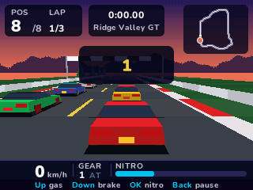
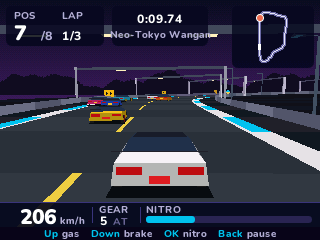
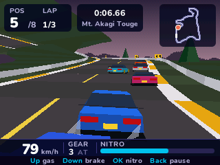
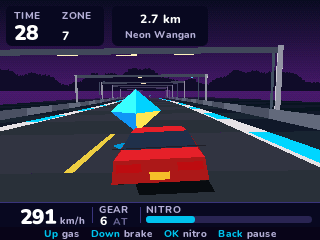
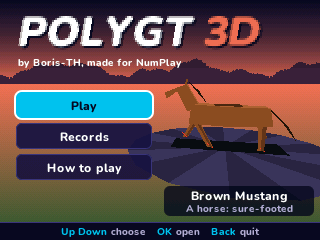
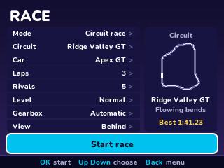

> **PolyGT 3D is a [NumPlay](../../README.md) game that comes on its own.** It is too big to fit next to NumPlay on the calculator. Get `PolyGT3D.nwa` from the [latest release](https://github.com/Mason363/NumPlay/releases/latest).

  

<h1 align="center">PolyGT 3D</h1>

  <b>A low-poly 3D racer for the NumWorks calculator.</b> 
  Three circuits, seven rivals and a road that never ends.

  <a href="https://github.com/Mason363/NumPlay/releases/latest/download/PolyGT3D.nwa"><b>Download PolyGT3D.nwa</b></a>
  &nbsp;·&nbsp; <a href="#controls">Controls</a>

  

## Highlights

* **Three circuits:** Ridge Valley GT at sunset, Neo-Tokyo Wangan at midnight and Mt. Akagi Touge at dusk, each with its own bends, hills and roadside.
* **Up to seven rivals** who brake for the bends, keep to their own lines, pass slower cars and grab nitro orbs, at three levels: Easy, Normal and Hard.
* **The endless road:** a road that goes on through five landscapes. Reach each zone before the clock runs out.
* **Three cars and two horses:** the Apex GT, Proto R and Rally IV, the Black Stallion and the Brown Mustang, each with its own top speed, pick-up and grip.
* **Nitro and the slipstream:** orbs on the road fill your nitro, and driving close behind a car pulls you along.
* **A ghost of your best lap** on each circuit, to race yourself.
* **Your way:** 1 to 9 laps, no rivals up to seven, automatic or manual gears, three views.
* **Saved as you go:** Home saves and quits, even in the middle of a race, and Continue picks it up. Your progress is also copied into `polygt3d_saves.py`, so installing the app again doesn't erase it.

<table>
  <tr>
    <td align="center"> Ridge Valley GT: seven rivals ahead</td>
    <td align="center"> Neo-Tokyo Wangan at midnight</td>
  </tr>
  <tr>
    <td align="center"> Mt. Akagi Touge, its hairpins and climbs</td>
    <td align="center"> The endless road, with a nitro orb</td>
  </tr>
  <tr>
    <td align="center"> The Brown Mustang, one of the two horses</td>
    <td align="center"> Choosing a race</td>
  </tr>
</table>

## How to play

You start at the back of the grid. Hold **Up** to accelerate, steer with **Left** and **Right**, and finish the laps ahead of as many rivals as you can. The map at the top right shows where everyone is.

Your car goes where it points. A bend you don't steer through carries you to its outside, and the faster you go, the less the tyres can turn you: brake before the tight bends (yellow arrows mark the sharpest). Brake while steering hard to slide round a hairpin, a tighter line for less braking. The grass slows you down, and so do the barriers.

**OK** burns nitro for more speed, and only the blue orbs on the road fill it up again. Driving close behind a car pulls you along. Each circuit keeps a ghost of your best lap, so you can race yourself.

On the endless road there are no rivals: reach each new zone before the time runs out. Every zone adds time, a little less each time.

## Controls

| Key | What it does |
| --- | --- |
| Up | Accelerate |
| Down | Brake (while steering hard: slide) |
| Left and Right | Steer |
| OK or EXE | Nitro |
| + and - | Change gear, with the manual gearbox |
| Back | Pause (Resume, Restart race, How to play, Quit game) |
| Home | Save and quit |

In the menus, the arrows choose, **OK** picks and **Back** goes back. 8, 4, 6, 2 and 5 work as the arrows and OK.

## Good to know

* **On its own:** PolyGT 3D is too big to fit next to NumPlay. Installing it from the NumWorks website swaps out NumPlay and the other apps, and installing NumPlay again swaps it back out. Your progress in each one is kept.
* **Quit game** in the pause menu asks first, and can take you back to the main menu instead. The race is kept either way.
* The ghosts are kept until you quit the game.
* There is no music or sound: the calculator has no speaker.

## Credits

PolyGT 3D by **Boris-TH**, made for NumPlay.

* The cars, the horses and the scenery were made for the game by Boris-TH.
* The text uses NumPlay's **Nunito** font (SIL Open Font License).

## License

The game's code and pictures are licensed under the GNU General Public License v3.0: see the `LICENSE` file at the root of the repository. Nunito keeps the SIL Open Font License (`LICENSES/OFL-1.1-Nunito.txt`).
