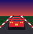
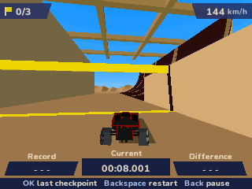
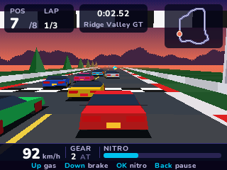
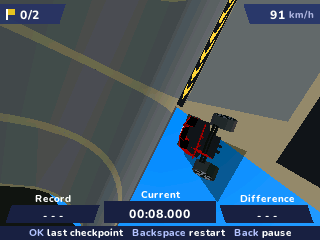
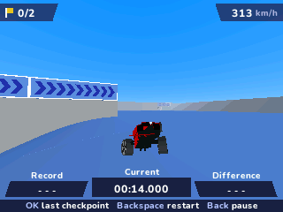
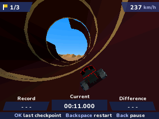
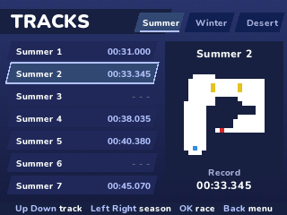
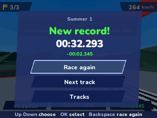

> **PolyTrack is a [NumPlay](../../README.md) game that comes on its own.** It is too big to fit next to NumPlay on the calculator. Get `PolyTrack.nwa` from the [latest release](https://github.com/Mason363/NumPlay/releases/latest).

  

<h1 align="center">PolyTrack</h1>

  <b>Kodub's low-poly time trial racer for the NumWorks calculator.</b> 
  All 17 tracks, with their loops, wall rides and jumps, against the clock and your ghost.

  <a href="https://github.com/Mason363/NumPlay/releases/latest/download/PolyTrack.nwa"><b>Download PolyTrack.nwa</b></a>
  &nbsp;·&nbsp; <a href="#controls">Controls</a>

  

## Highlights

* **The 17 official tracks:** Summer 1 to 7, Winter 1 to 5 and Desert 1 to 5, built from PolyTrack's own track files and parts: slopes, loops, wall rides, jumps and roads up walls.
* **PolyTrack's car and physics:** the same car, its suspension, grip, downforce and steering, worked out 1000 times a second as in the game, so a track drives the way it does on a computer.
* **Time trials:** go through every checkpoint in order, then over the finish line. **OK** puts you back at the last checkpoint, **Backspace** starts over at once.
* **Records and splits:** your best time on each track and its checkpoint times. At each checkpoint you see how far ahead (green) or behind (red) of your record you are.
* **Your ghost:** a ghost car drives your best run, as long as it is under two minutes. The ghosts of the last tracks you set records on are kept between games.
* **Your car:** eight colours, and the view from behind the car or from the cockpit.
* **Saved as you go:** Home saves and quits from anywhere. Your progress is also copied into `polytrack_saves.py`, so installing the app again doesn't erase it.

<table>
  <tr>
    <td align="center"> Summer 1: down from the start</td>
    <td align="center"> Summer 2's wall ride</td>
  </tr>
  <tr>
    <td align="center"> Winter 2</td>
    <td align="center"> Desert 4</td>
  </tr>
  <tr>
    <td align="center"> The tracks, each with its map and record</td>
    <td align="center"> A new record at the finish</td>
  </tr>
</table>

## How to play

Pick a track. The clock starts when you start driving: hold **Up** to accelerate, steer with **Left** and **Right**, and **Down** to brake (held when stopped, it reverses). Go through the checkpoints, the ones with a yellow banner, in order, then over the finish line. The top left shows how many checkpoints you have, the bottom your record, your time and the difference.

The car is light and fast. Ease off before tight bends, take loops and wall rides flat out, and keep straight for the jumps. In the air, **Down** steadies the car. If you fall off or get stuck, **OK** takes you back to the last checkpoint, still against the clock, and **Backspace** starts the run over.

## Controls

| Key | What it does |
| --- | --- |
| Up | Accelerate |
| Down | Brake, then reverse |
| Left and Right | Steer |
| OK or EXE | Back to the last checkpoint |
| Backspace | Start the run over |
| Toolbox | Behind the car or the cockpit |
| Back | Pause (Resume, Restart, How to play, Quit game) |
| Home | Save and quit |

In the menus, the arrows choose, **OK** picks and **Back** goes back. 8, 4, 6, 2 and 5 work as the arrows and OK.

## Good to know

* **On its own:** PolyTrack is too big to fit next to NumPlay. Installing it from the NumWorks website swaps out NumPlay and the other apps, and installing NumPlay again swaps it back out. Your progress in each one is kept.
* **Quit game** in the pause menu asks first: keep racing, go back to the tracks, or quit.
* On the busiest tracks the far scenery is drawn simpler, so that the race keeps going at 30 frames a second, even on the N0110.
* The ghosts take up to 12 KB in `polytrack_ghosts.sav`. There is no music or sound: the calculator has no speaker.

## Credits

Made for NumPlay, inspired by [PolyTrack](https://www.kodub.com/apps/polytrack) by **Kodub**. Not affiliated with Kodub.

* Taken from PolyTrack's web build: the 17 tracks, the track parts' and the car's models (simplified for the calculator), their colours in each season, the sky, light and mountains, the car's physics numbers, the screens' colours and hints, the track maps, the logo and the icon.
* The 3D engine is Boris-TH's, from PolyGT 3D.
* The text uses NumPlay's **Nunito** font (SIL Open Font License).

## License

The game's code is licensed under the GNU General Public License v3.0: see the `LICENSE` file at the root of the repository. PolyTrack's tracks, models and pictures belong to Kodub. Nunito keeps the SIL Open Font License (`LICENSES/OFL-1.1-Nunito.txt`).
