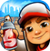
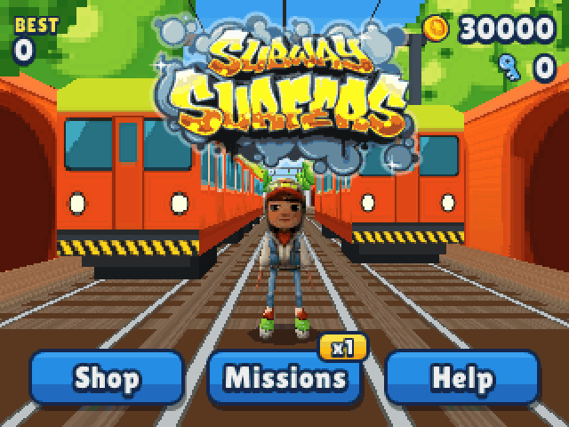
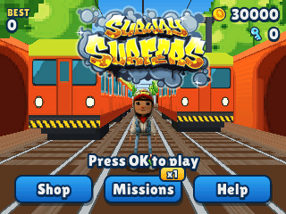
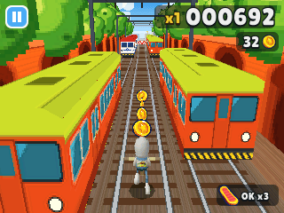
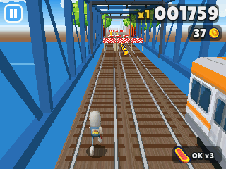
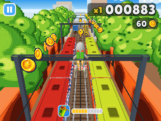
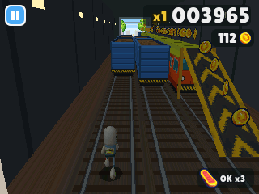
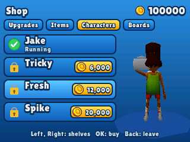

> **Subway Surfers is a [NumPlay](../../README.md) game that comes on its own.** It is too big to sit next to NumPlay. Get `SubwaySurfers.nwa` from the [latest release](https://github.com/Mason363/NumPlay/releases/latest).

  

<h1 align="center">Subway Surfers</h1>

  <b>Dash down the subway's tracks, dodge the trains and outrun the Inspector, on the NumWorks calculator.</b> 
  The endless run in 3D, seen from behind and above like on phones, with its coins, power-ups, hoverboards, missions and shop.

  <a href="https://github.com/Mason363/NumPlay/releases/latest/download/SubwaySurfers.nwa"><b>Download SubwaySurfers.nwa</b></a>
  &nbsp;·&nbsp; <a href="#controls">Controls</a>

  

## Highlights

* **Three tracks in real 3D:** trains standing on them and trains coming at you with their lights on, ramps up onto the roofs, low barriers to jump, high ones to roll under and big ones to go round. Running along the roofs and jumping from one train to the next is often the way through.
* **The classic yard:** the orange viaduct with its arches and the bushy trees over it, the overhead wires on their gantries, blue steel bridges over the water, stretches of concrete wall with graffiti and houses behind, stations with their platforms, and tunnels into the dark. The trains wear the game's liveries: the orange and lime commuter train, the silver one, the red, white and blue one, the blue open wagons and the green box cars.
* **The game's own people:** Jake, Tricky, Fresh (with his boombox) and Spike, and the Inspector and his dog, built on the game's own 3D models and wearing their textures, with smooth shading. They run, jump, roll, stumble, surf and fly with keyframed animations, and Jake's vest has the Sub Surf graffiti on its back.
* **The Inspector and his dog:** they chase you off at the start. Hit the side of a train or a barrier's edge and you stumble: they're right behind you, and if you stumble again before they give up, you're caught. Run into anything head-on and it's over.
* **Faster and faster:** the longer you run, the faster it goes, and the harder the tracks get.
* **Coins everywhere:** in lines down the tracks, in arcs over the barriers, up the ramps and along the roofs, and high in the sky for the jetpack.
* **Power-ups:** the **Jetpack** flies you over everything, **Super Sneakers** jump high enough to land on the trains, the **Coin Magnet** pulls in every coin near you and the **2x Multiplier** doubles your score. **Mystery boxes** hold coins, keys, hoverboards and more, and **keys** turn up now and then.
* **Hoverboards:** OK rides one for 30 seconds, and a crash only breaks the board. Three boards: the classic **Hoverboard**, the **Bouncer** (super jumps) and the **Daredevil** (faster).
* **Headstarts and score boosters:** at the start of a run, 1 flies you far ahead and 3 adds 5 to your score multiplier.
* **Save me!** Crashed? Spend a key to keep going: then 2, 4, 8...
* **Missions:** sets of three, like "Jump 25 times in one run" or "Run 150 m on top of trains". Finish a set and your score multiplier goes up, all the way to x30.
* **The shop:** upgrade each power-up to make it last longer (six levels, up to 30 seconds), buy hoverboards, headstarts, score boosters and mystery boxes, and unlock **Jake**, **Tricky**, **Fresh** and **Spike** and the boards.
* **Smooth:** the world is drawn in 3D, a band of the screen at a time, at 30 frames a second or more on every calculator.
* **Saved:** your coins, keys, best score, items, upgrades, characters, boards and missions. Home or On/Off in a run keeps the coins you've picked up. The save is also copied into `subway_saves.py`, so installing the app again doesn't erase it.

<table>
  <tr>
    <td align="center" width="50%"></td>
    <td align="center" width="50%"></td>
  </tr>
  <tr>
    <td align="center"></td>
    <td align="center"></td>
  </tr>
  <tr>
    <td align="center"></td>
    <td align="center"></td>
  </tr>
</table>

## Controls

| Key | Action |
| --- | --- |
| Left, Right, or 4 6 | Change tracks |
| Up or 8 | Jump |
| Down or 2 | Roll; in the air, dive down and roll |
| OK, EXE or 5 | Ride a hoverboard; choose, buy |
| 1 | A headstart (at the start of a run) |
| 3 | A score booster (at the start of a run) |
| Back or ⌫ | Pause (Resume, Quit game); back in the menus |
| Home or On/Off | Save and quit |

On the title, OK plays, and Down goes to the **Shop**, the **Missions** and **Help**. In the shop, Left and Right go from shelf to shelf.

## Good to know

* **One app at a time:** Subway Surfers is too big to sit next to NumPlay or the other big games. Installing it from the NumWorks website swaps them out, and installing them again swaps it out. Your saves in each one are kept.
* **No clock, no daily rewards:** the calculator has no clock, so there are no daily challenges or word hunts.
* **No music or sound:** the calculator has no speaker.
* **Where the pictures come from:** the people are fitted to the game's own 3D models as the Subway Surfers Wiki shows them from the front, and wear those pictures as their textures; the logo and the icons of coins, keys, power-ups and items are the wiki's. The yard, the trains, the barriers and the dog are drawn after the game.

## Credits

Inspired by Subway Surfers by SYBO and Kiloo, not affiliated with them.

* The people's looks (Jake, Tricky, Fresh, Spike and the Inspector: their outlines and textures), the logo and the icons of coins, keys, power-ups and items come from the [Subway Surfers Wiki](https://subwaysurf.fandom.com): its pictures of the game's 3D models, its logo and its item icons.
* The lettering is the **Lilita One** font by Juan Montoreano, under the SIL Open Font License ([license](../../LICENSES/OFL-1.1-LilitaOne.txt)).

Made by Mason Chen as part of NumPlay.

Build: `make` (needs `arm-none-eabi-gcc` and Node.js for nwlink); `make test` plays it on a computer. `make data` gathers the wiki's pictures (`tools/fetch.py`) and turns them into `src/data.c` (`tools/pack.py`, with `tools/models.py` for the people and `tools/scenery.py` for the yard); the result is committed, so building needs no network.

## License

The game's code is licensed under the GNU General Public License v3.0: see the `LICENSE` file at the root of the repository. The game's pictures and the font keep their own terms (see Credits).
