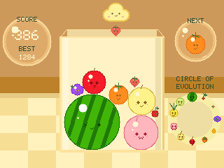
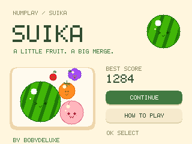

# Suika Game

An English-only fruit-merging game for NumWorks, rebuilt for NumPlay.
Match two identical fruits to grow the next one, from cherry to watermelon.
Each merge awards its base value: 1, 3, 6, 10, 15, 21, 28, 36, 45, 55 or 66
points. Two watermelons clear each other. There are no combo bonuses.

**Game made by [Bobydeluxe](https://github.com/Bobydeluxe).**




| Key | Action |
| --- | --- |
| Left / Right | Move the cloud |
| OK / EXE | Drop one fruit (holding does not repeat) |
| Back | Pause / resume |
| Home / On-Off | Save and leave |

Only the next fruit is shown. The cloud holds the fruit ready to drop. Each
new fruit is an independent, equally weighted draw from cherry, strawberry,
grape, dekopon and persimmon. Repeats and streaks are possible. There is no
reserve, three-fruit queue, bag, position suggestion or landing guide.

The warm checked background, glass box, cloud, score/Next bubbles, evolution
circle, fruit proportions, colours and expressions are adapted at 320 x 240
from the classic skin shown in the [official screenshots](https://www.nintendo.com/us/store/products/suika-game-switch/).
Fruit radii are 5, 7, 9, 11, 14, 17, 20, 25, 28, 31 and 40 calculator pixels;
this is a small-screen procedural interpretation, not the original sprites.

Newly dropped fruit has time to fall before counting toward overflow. A mature
fruit protruding above the box triggers a red rim warning. It has 180 simulation
ticks (2.88 seconds) to settle or merge; clearing the rim resets the timer.
The 48-body pool blocks overlapping or excess drops while the pile settles.

Pause freezes simulation. **New game** asks before discarding a run and keeps
the record. **Title screen** leaves the run available under **Continue**.
Back on the title returns to NumPlay.

## Memory and saves

No heap or full-screen framebuffer. Fruit, faces and scenery are drawn with
code. Only dirty regions are composed, at most eight rows at a time (5120
bytes). Physics uses two substeps and six contact passes per 16 ms tick;
drawing runs at up to 31.25 Hz with bounded simulation catch-up.

The fixed 608-byte `suika.sav` payload now uses version `SKA2`. It preserves
the run, best score, random generator, current fruit, single next fruit and
danger timer. Existing NumPlay `SKA1` saves are imported: scores and fruit
ranks remain, positions are scaled/clamped to the new box, and removed
reserve/queue/combo state is discarded. The pile settles under the updated
geometry on resuming. Historical scores are kept as earned. A save written
by this update cannot be loaded by the previous app. NumGames `.nwa` saves
are not imported.

Length, checksum and field validation finish before loading live state.
Writes occur on pause, game over, exit and every five seconds while playing,
skipping identical payloads. Save failures offer retry, return to play or
explicit exit without saving. The existing NumPlay backup/reset/uninstall
mechanisms cover the same registered save record.

## Build and check

With ARM GCC, nwlink 1.0.0 and Python/pyelftools available:

```sh
make -C games/suika build check NWLINK=nwlink
make -C games/suika test
python tests/test_suika.py games/suika/output/suika-debug.nwa --nwlink nwlink
```

The host suite must run before the ARM scenarios to generate the scene fixture.
The release output is `games/suika/output/suika.nwa`. The root build copies it
to `build/apps/SuikaGame.nwa` and includes the separate module in NumPlay.
The portable standalone build also works on Windows:

```sh
python games/suika/tools/build.py --toolchain /path/to/arm/bin --nwlink /path/to/nwlink/bin/nwlink
```

It writes `output/SuikaGame.nwa` and four-profile size/link reports. Standalone
packing uses the game-local lossless NWA/icon packer, with no extra runtime memory.
The debug and release files must produce identical installed bytes on all
profiles. The build enforces 12 KiB static RAM and 64 KiB installed flash limits.
Pillow is needed to regenerate the icon with `tools/icon.py`.

See [validation](VALIDATION.md) for measured results. Code and procedural
artwork are under the repository's GPL-3.0 licence. Inspired by Suika Game;
not affiliated with Aladdin X. No original game's artwork or binary is included.
