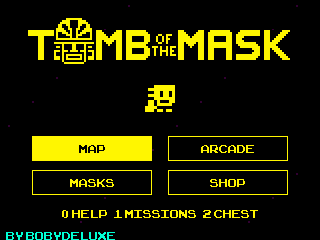
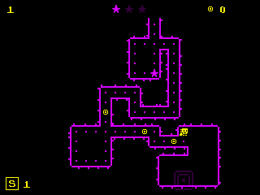

# Tomb of the Mask

Native NumWorks adaptation by **Bobydeluxe**, based on the supplied Unity web
version of Happymagenta and Playgendary's Tomb of the Mask.

Includes the **200 original stage layouts**, **517 arcade sections**, original
monochrome sprites, logo, pixel font and colour palettes, and **16 masks**.
The original default tables supply mask unlock levels and prices, experience
thresholds, upgrade prices, power-up effects, mask advantages and mission goals.

 

## Play

| Key | Action |
| --- | --- |
| Arrows | Dash to the next wall; choose menus |
| OK / EXE | Confirm; use an owned shield during play |
| BACK | Pause; return from menus |
| HOME / Power | Save and exit |
| 0 on the title screen | Controls |
| 1 on the title screen | Missions |
| 2 on the title screen | Chest and reward wheel |

**Map** selects a stage. Collect stars and dots, avoid the traps and reach the
green exit. Completing a stage unlocks the next one. Getting every dot earns
the original 25-coin bonus. Best star ratings and all-dot completions are saved.

**Arcade** joins original sections into an endless climb. Keep ahead of the
rising tide. New sections replace the bottom of a fixed-size window, so a long
run does not increase RAM use. The best score is saved.

**Masks** displays each mask's original level requirement, price and benefits.
**Shop** sells shields and the nine upgrades of each power-up. Coins, experience,
owned masks, upgrades, mission progress and chest rewards persist between launches.
The eight mission categories use the reference's goals and reward tables.

## Calculator adaptations

This is a native C reimplementation, rather than Unity running on a calculator.
The original stage tile data is preserved exactly, including the four stars in
stages 90 and 117. Dash timing uses the original 5-unit movement speed and
0.12-unit tile size, with a fixed 60 Hz simulation. Bounded grid collision,
enemy movement and arcade section selection are native implementations; their
results are not claimed to be bit-for-bit identical to Unity's physics or RNG.

Menus fit the 320 × 240 display and use calculator keys. All text is English.
Sprites use their original pixel dimensions; their monochrome colours and
transparency are packed separately. The small font's missing punctuation comes
from fonts embedded in the supplied game.

There is no sound, advertising, online purchase, subscription or notification
service. Retries do not consume mobile energy. The reward wheel uses in-game
coins only. Its first chest is free; the original four-hour free-chest cooldown
counts active playing time because the app does not require an online clock.
The next free chest and mission progress survive closing the app.

`tombmask.sav` uses **320 bytes**, with a version and CRC. Full storage offers
retry, return to the menu, and exit without saving; it does not delete other
files. An unfinished stage restarts when launched again. Completed progression
and rewards remain saved.

## Build

Requires ARM GCC, Python with Pillow, Node.js and nwlink. All converted assets
are checked in; ordinary builds need neither Unity nor a network download.

```sh
python build.py --arm-bin /path/to/arm/bin --nwlink /path/to/nwlink
```

This produces `output/tombofthemask.nwa` and copies it to
`../../build/apps/TombOfTheMask.nwa`. The same app targets N0110, N0115 and N0120,
and is checked against Upsilon's smaller RAM allocation.

```sh
make build check
make test
make test-assets
make test-arm
```

`HOST_CC`, `PYTHON` and `NWLINK` can override tools. ARM tests require Unicorn,
pyelftools and Pillow. Run the build and host tests before the ARM tests.
See [VALIDATION.md](VALIDATION.md) for measurements and test coverage.

Tomb of the Mask installs separately from the launcher and is excluded from
`games/games.json`. From the repository root, build it with
`make build/data/apps/TombOfTheMask.nwa` or
`python tools/build.py --game tombofthemask`. Release tooling lists
`TombOfTheMask.nwa` among the individual large games.

## Credits

- Original Tomb of the Mask and artwork: **Happymagenta / Playgendary**.
- Fonts from the supplied build: **hm_pxl_01 / ArcadeClassic**, with **Roboto Bold**
  for missing punctuation.
- Native calculator adaptation: **Bobydeluxe**. In-game credit: **By Bobydeluxe**.
- [Pinned reference build](https://github.com/Gr4ys0n/Gr4ys0n.github.io/tree/29006b0f11904704c390b457f7055c9fa1e53484/public/assets/games/tomb-of-the-mask).
- [Asset conversion and provenance](ASSETS.md).

Unofficial adaptation, not affiliated with Happymagenta or Playgendary.
