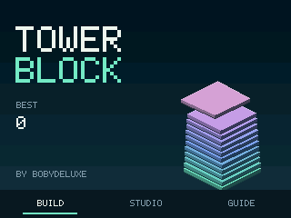
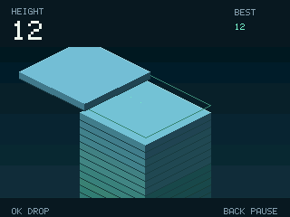

# Tower Block

Game made by **Bobydeluxe**.

An original NumWorks implementation inspired by
[Tower Block on Y8, by Sumalya](https://fr.y8.com/games/tower_block).
The reference uses moving 3D slabs: place each one on the tower and the
overhanging portion falls away. This version recreates that mechanic with
original code and procedural isometric artwork. No original game assets or
source code are included.




The English interface uses a restrained night theme: a clear sky, geometric
typography, an isometric tower, a horizontal title menu and compact side panels.
During play, height, the personal record, brief placement feedback and key hints
leave room for the tower. Studio and the guide keep the remaining options easy
to find.

## Play

Install `TowerBlock.nwa` with a compatible NumWorks external-app installer.
Open Tower Block from the calculator's Home menu after installation.

| Key | Action |
| --- | --- |
| Left / Right | Choose a title-menu item |
| OK / EXE | Select; start or resume motion; place the moving slab |
| Back | Pause or return |
| Home / On-Off | Save and exit |
| Up / Down | Choose a pause or Studio item |

Release the key between placements. The ready screen starts motion with one
press; the next fresh press places the slab. Inputs during the short landing
animation are ignored so a held key cannot drop the following slab.

- **Build:** alternate between the two isometric axes and stack as high as
  possible. Excess material is cut away. A completely missed slab ends the run.
  Height is the number of slabs placed above the foundation.
- **Perfects:** align within 1.5 world units to keep the whole slab. Every third
  consecutive perfect restores up to two units on the current axis, capped at
  the initial size. At least a quarter-unit of overlap must remain after a cut.
- **Studio:** four palettes (Prism, Aurora, Ember, Mono), an optional alignment
  guide and reduced-animation mode. Palettes are cosmetic and freely available.

The current tower, placement phase, direction, personal best and preferences
are saved. Returning from pause or reopening a save waits for a fresh start
press. The title has three entries: **Build / Resume**, **Studio** and **Guide**.
**Resume** continues the active tower. **New Build** from pause asks before
replacing it. A full-storage exit offers Retry, Return, or an explicit unsaved
exit.

Practice has been removed. The new `TBK2` save imports old `TBK1` saves:
normal towers resume with their original personal best, while former Practice
towers become fresh normal games. The old Practice record is discarded and
is never promoted to the normal personal best. Preferences and lifetime
counters are retained. Older app versions cannot read `TBK2` saves.

## Build

Requires ARM GCC, Python 3, Node.js and nwlink 1.0.0:

```sh
make build
make check

# Optional build without Make, including Windows
python tools/icon.py
python tools/build.py --toolchain /path/to/arm/bin --nwlink /path/to/nwlink/bin/nwlink
```

The Python builder also needs Pillow and pyelftools. It produces the standalone
`output/TowerBlock.nwa`, an unstripped debug binary, an optional module object and four
linked profiles with their sizes in `output/sizes.json`.
The game-local standard-library Python packer groups standalone ELF sections and
compresses the launcher icon losslessly. Installed flash is 14,248 bytes; the
downloadable NWA is 20,160 bytes. Artwork and normal-run save compatibility
are retained. Unused ARM mapping symbols are removed from the
release transport file; the debug build keeps them for disassembly. The Python
builder checks release/debug installed bytes on all four profiles.

```sh
make test
python tests/arm.py --nwlink /path/to/nwlink
python tests/test_compact_nwa.py
```

The host test creates the input trace and tall-tower fixture used by the ARM
test. ARM tests require Unicorn, pyelftools and Pillow and reuse the repository's
CPU emulator. See [VALIDATION.md](VALIDATION.md) for measured results and limits.

## Resources

The engine uses integer fixed-point coordinates, no heap and no full-screen
framebuffer. Only the last 24 floors are kept for drawing, regardless of tower
height. Three reusable falling fragments bound visual effects. RGB565 rendering
uses a 5,120-byte strip buffer and clips polygon scanlines to dirty regions.
Save payload: 384 bytes. Cosmetic falling fragments are intentionally omitted
from saves; the tower and next placement remain intact.

Licensed under GPL-3.0-only, like NumPlay.
