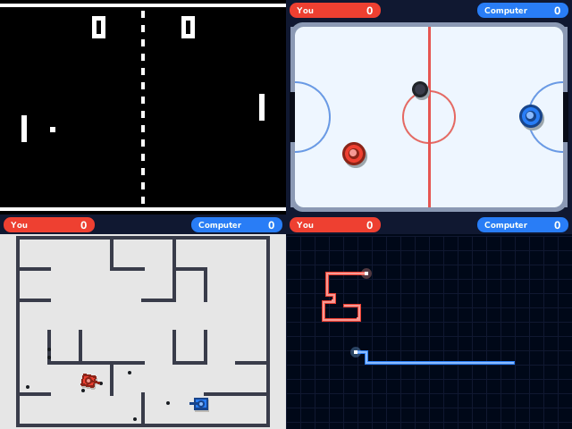

# 2 Players

Pong and three more games for two people on one calculator, side by side: player 1 on the arrows, player 2 on the keys around +, both at once. No one to play with? Player 2 can be the computer, easy, normal or hard.

- **Pong**, the 1972 arcade game: black and white, the dashed net and the blocky scores. The paddle has eight segments: the two in the middle send the ball back straight, the others at steeper and steeper angles. The ball speeds up as a rally goes on, and the first to 11 wins.
- **Air Hockey**: a mallet each, in your own half, and a puck that slides and bounces off the rails and the goal posts. Hit it while you move to send it flying. First to 7.
- **Tanks**: a new maze every round, shells that bounce off the walls (five each at a time) and can hit the tank that fired them. First to 5 rounds.
- **Light Cycles**: never stop, never turn back, and make the other cycle crash into a wall or a trail. Two turns can wait in line, and the cycles speed up as the round goes on. First to 5 rounds.
- **Before each game**, a map of the calculator's keyboard lights up each player's keys in their colour, with the rules.
- **The computer** plays every game: in Pong it works out where the ball will come and aims at the corners, in Air Hockey it gets behind the puck to shoot or guards its goal, its tank finds its way through the maze and plans shots off the walls, and its light cycle keeps the most room for itself and, on hard, cuts you off.
- **The matches won** by each side are kept for every game, against a friend and against the computer.

## Controls

| | Player 1 | Player 2 |
| --- | --- | --- |
| Move (in Pong, up and down) | Arrows | × up, Ans down, 3 left, − right |
| Fire (Tanks) | shift | EXE |

| Key | Action |
| --- | --- |
| Up, Down, OK | Pick a game, then OK to play |
| Left, Right | Player 2, or the computer: easy, normal, hard |
| Back | Pause: Resume, Restart, Other games, Quit game |
| Home | Quit |

Against the computer, OK and EXE fire too.

## Credits

**Pong** is Atari's arcade game (1972, by Allan Alcorn), whose paddles and ball this one follows. Air hockey, tanks duelling in a maze in the spirit of Tank Trouble, and the light cycles of the film Tron (1982) are classics of two-player games. Everything here is written in C for NumPlay and drawn from shapes as it goes, with no code or art from any of them.

Inside NumPlay it draws with the launcher's own shapes and fonts and saves through its file functions, so the four games take about 13 KB.

It comes inside [NumPlay](https://github.com/Mason363/NumPlay), or on its own as `TwoPlayers.nwa` from the [latest release](https://github.com/Mason363/NumPlay/releases/latest).

Build: `make` (needs `arm-none-eabi-gcc` and Node.js for nwlink). `tools/bot.py` plays it against the computer in the emulator for these pictures.
