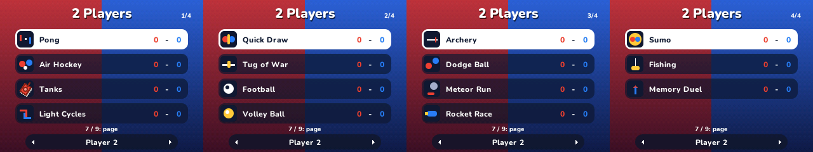
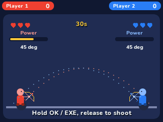

# 2 Players

Fifteen mini-games inside the existing **2 Players** app in NumPlay, side by side: player 1 on the arrows, player 2 on the keys around +, both at once. No one to play with? Player 2 can be the computer, easy, normal or hard.

- **Pong**, the 1972 arcade game: black and white, the dashed net and the blocky scores. The paddle has eight segments: the two in the middle send the ball back straight, the others at steeper and steeper angles. The ball speeds up as a rally goes on, and the first to 11 wins.
- **Air Hockey**: a mallet each, in your own half, and a puck that slides and bounces off the rails and the goal posts. Hit it while you move to send it flying. First to 7.
- **Tanks**: a new maze every round, shells that bounce off the walls (five each at a time) and can hit the tank that fired them. First to 5 rounds.
- **Light Cycles**: never stop, never turn back, and make the other cycle crash into a wall or a trail. Two turns can wait in line, and the cycles speed up as the round goes on. First to 5 rounds.
- **Before each game**, a map of the calculator's keyboard lights up each player's keys in their colour, with the rules.
- **The computer** has three approachable difficulty levels, with reaction delays, imperfect aiming and slower attack cadence. It does not borrow Player 2’s physical inputs in solo mode.
- **The matches won** by each side are kept for every game, against a friend and against the computer.

## Eleven additional games

The original four games keep their IDs, rules and artwork. The additions use the same red/blue teams, night-blue cards, rounded shapes, fonts, score bar and keyboard tutorial. There are no separate apps for these mini-games.

| Game | How to play | First to |
| --- | --- | ---: |
| Quick Draw | Wait for DRAW, then press Action; a false start loses | 5 |
| Tug of War | Tap and release Action to pull the flag across your line | 5 |
| Football | Move, push the ball and kick with Action | 5 |
| Volley Ball | Move sideways, jump with Up or Action; keep the ball off your floor | 7 |
| Archery | Aim with Up/Down; follow the dotted trajectory, charge with OK / EXE and release to shoot | 5 |
| Dodge Ball | Move in your half, throw with Action; three hits knock out | 5 |
| Meteor Run | Move sideways; survive the same falling rocks as your rival | 5 |
| Rocket Race | Tap Up or Action to fly through identical obstacle courses | 5 |
| Sumo | Move and dash with Action; push your rival out of the shrinking ring | 5 |
| Fishing | Move the rod, hold Action to lower the hook, release to reel in a fish | 5 |
| Memory Duel | Watch a shared arrow sequence, then repeat it without a mistake | 5 |

All fifteen games support two people and the existing easy/normal/hard computer choices. Simultaneous outcomes draw when possible. New survival/duel rounds have time limits; a tied round awards neither side a point. Each game's wins against a friend and against the computer are kept separately.

## Controls

| | Player 1 | Player 2 |
| --- | --- | --- |
| Move (in Pong, up and down) | Arrows | × up, Ans down, 3 left, − right |
| Action (shoot, jump, pull, dash, fish) | OK | EXE |

| Key | Action |
| --- | --- |
| Up, Down, OK | Pick a game, then OK to play |
| 7, 9 | Previous / next page of four games |
| Left, Right | Player 2, or the computer: easy, normal, hard |
| Back | Pause: Resume, Restart, Other games, Quit game |
| Home, Power | Save and quit |

OK is Player 1’s Action key in both modes. Against the computer, EXE is also a solo alias; in two-player mode, EXE belongs only to Player 2. Shift is no longer used. Hold actions are supported for archery and fishing. Each tutorial highlights only the keys used by that game. Confirm keys held while opening a screen must be released before acting again.

## Saves and footprint

The same `twoplayer.sav` record is used. Original 36-byte version 1 saves and the previous sixteen-game version 2 saves migrate automatically. Version 3 uses 128 bytes with explicit little-endian encoding and CRC-32. Memory Duel's wins are kept when its ID moves; only the removed game's counters are discarded. If it was the last selection, the menu opens at Pong instead. A malformed save is rejected before changing progress. Full storage shows a retry / explicit unsaved-exit choice when quitting.

The added games share **352 bytes** of working state, fixed projectile pools and procedural artwork; there are no imported images or sound files in the game. The installed standalone package is **53,912 bytes** (about 52.6 KiB). In NumPlay the module uses **33,597 bytes** of code/read-only data and **22,052 bytes** of shared arena RAM. It reuses the launcher's fonts and drawing functions. A fixed 8 ms physics step keeps gameplay independent of the LCD frame rate; rendering targets roughly 30 frames per second.

## Readability and difficulty

Archery now has clearly drawn bows and directional arrows, coloured trajectory dots, angle readouts, power gauges, hit feedback and three visible hearts. Hold OK / EXE to increase power and release to shoot. The preview follows the same gravity and launch power as the real arrow. The two-player keyboard tutorial highlights OK beside Player 1's arrows and keeps EXE on Player 2's side.

The other games retain their established layouts. Targeted additions show Football's round clock, Dodge Ball's hearts, Rocket Race's boost flame and Fishing's hold/release prompts. Tanks' tutorial explicitly distinguishes driving from turning.

Computer difficulty is reduced across all fifteen games: sampled movement decisions instead of instant tracking, lower movement speeds where needed, aiming errors, longer reloads, slower tugging and memory playback, and longer Quick Draw reactions. Light Cycles no longer predicts and blocks the player's next possible cells. Hard remains faster and more accurate than Easy, without the old perfect responses.

## Credits

**Pong** is Atari's arcade game (1972, by Allan Alcorn), whose paddles and ball this one follows. Air hockey, tanks duelling in a maze in the spirit of Tank Trouble, and the light cycles of the film Tron (1982) are classics of two-player games. Everything here is written in C for NumPlay and drawn from shapes as it goes, with no code or art from any of them.

**Additional mini-games by [Bobydeluxe](https://github.com/Bobydeluxe)**. Inspired by the short local duels of [GoBattle 2](https://poki.com/fr/g/gobattle2) by YouDevice! and [12 MiniBattles](https://poki.com/fr/g/12-minibattles) by Shared Dreams Studio, together with familiar sports, reaction, memory and survival games. These are native calculator implementations using NumPlay's existing visual style, with no code, images or sounds imported from those games. The original four games remain credited to their existing authors and inspirations above.

It comes inside [NumPlay](https://github.com/Mason363/NumPlay), or on its own as `TwoPlayers.nwa` from the [latest release](https://github.com/Mason363/NumPlay/releases/latest).

## Build and verification

Build from this directory with `make build module check` (ARM GCC, Make and nwlink required). The normal NumPlay root build discovers the same `twoplayer` module and `TwoPlayers.nwa` release name through `games/games.json`; Upsilon includes it too.

- `make test HOST_CC=gcc`: native mechanics, saves, complete CPU matches, random inputs and rendering.
- `make test-arm PYTHON=python3`: actual ARM package, real keypad menus and firmware guards on four memory profiles (Python Unicorn, pyelftools and Pillow required).
- `make test-integration PYTHON=python3`: compile the actual launcher with a deliberately single-module **test catalogue**, then verify module entry, return, re-entry and shared save backup. This test build is not a full NumPlay release.
- `python3 tests/test_languages.py`: French/Chinese string coverage, font generation and the same host/layout checks. Nunito is downloaded from its upstream font source on the first run.

See [VALIDATION.md](VALIDATION.md) for measured results and limits. No physical calculator was connected for these checks. `output/` holds generated reports and screenshots.
